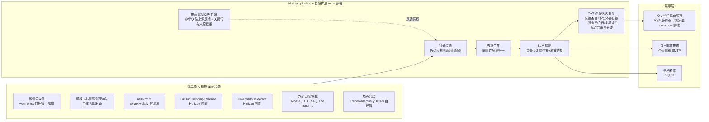

# AI / 具身智能资讯聚合平台：调研与方案报告（v2）

> v1：2026-10-20 调研（现状盘点、开源项目对比）
> v2：2026-10-20 二次沟通后更新（新增硬性约束、项目目标与最终产品形态、零费用架构修订、第一步详细计划与验收标准）
> v2.1：2026-10-20 三次沟通后更新（Docker 放开可装、本机代理可用、API 密钥改为 .env 自填、邮箱后置到阶段 4、零订阅费硬规则、执行清单拆分至 doc/todo.md）
> 状态：方案确认采用"Horizon 主壳"路线；Horizon 已克隆到 app/Horizon 并完成源码检测（**原生支持自定义 base_url，无需补丁**）；执行进度与详细 todolist 见 [todo.md](todo.md)

---

## 一、需求拆解

### 1.1 v1 核心需求

| # | 需求 | 说明 |
|---|------|------|
| R1 | 每条信息 1~2 句话摘要 | 一眼扫完，不刷屏 |
| R2 | 每日/每周综合汇总 | 把当天（当周）所有信息综合成一段"最近发生了什么" |
| R3 | 原文链接可点 | 感兴趣的点进来源查看 |
| R4 | 多信息源接入/删除 | 微信公众号（如机器之心）、RSS、其他 AI 总结项目（如 AIbase 日报）均可插拔 |
| R5 | 相似信息关联/去重 | 同一件事多家媒体报道时合并 |
| R6 | 推荐板块 | 根据口味推荐相关新闻，可从推荐中"关注"新来源 |
| R7 | 用户可调教 | 兴趣关键词、来源权重、摘要风格、屏蔽规则均可自定义 |
| R8 | 覆盖范围 | 产品动态（特斯拉新车）、新工具（MUSE）、论文（MEM1 递归自我改进）、国内动态（小红书 dots.ocr，即 "DOIC"） |

### 1.2 v2 新增需求与限制

| # | 需求/限制 | 落到方案里的影响 |
|---|-----------|-----------------|
| R9 | **零订阅费（硬规则）**：除调用个人 API（LLM 分析、邮件等操作）外，不允许任何其他费用；凡有付费成分的方案**直接不考虑**，不设付费兜底 | 移除 X/Twitter 源（Apify 付费）；wechat2rss 整体弃用；公众号主用自托管 we-mp-rss；全部服务自托管在本机 |
| R10 | **前端要好看**：套用某个开源项目的前端页面 | MVP 用 Horizon 自带 Markdown/静态页；终版套 newsnow 前端（见 8.2） |
| R11 | **独有综合总结**：综合**多份日报/周报**（机器之心、AIbase、TLDR AI、The Batch 等）生成自己的总结，不只是罗列原文 | 新增 SoS（Summary-of-Summaries）模块（见 8.1 B4） |
| R12 | **部署在本服务器**，使用 Docker 或虚拟环境 | 用户已放开 Docker 安装权限（sudo 需密码，需时安装）；轻组件（Horizon/自研）用 **uv 虚拟环境**，重组件（RSSHub/we-mp-rss/newsnow）用 **Docker** |
| R13 | 先不写代码；第一步要有**详细计划 + 验收标准** | 见第九章 9.2 |

---

## 二、硬性约束（v2 确认）

### 2.1 费用白名单

| 类别 | 允许 | 禁止 |
|------|------|------|
| LLM | 用户个人 API（OpenAI 兼容接口，用于打分/摘要/综合） | 任何按月订阅的 AI 服务 |
| 通知 | 用户个人邮箱 SMTP/API 发送 | 付费推送服务 |
| 信息源 | 免费 RSS、免费 API（HN/Reddit/GitHub/GDELT/Google News）、自托管采集（we-mp-rss、RSSHub、newsnow、TrendRadar） | X/Apify、付费 wechat2rss 档、付费数据库 |
| 部署 | 本服务器 + uv venv（轻组件）+ Docker（重组件，已获安装许可） | 云主机租用 |

### 2.2 部署环境实测（2026-10-20，含代理复测）

- CPU 8 核 / 内存 11GiB（可用 8.7GiB）/ 磁盘剩余 16G —— 足够
- Python 3.12.3 ✓、git 2.43 ✓（身份已配置）；Docker/node 未安装、uv 未安装（pip 装即可）；sudo 需密码
- **用户已配置代理：`http://127.0.0.1:7897` 可用**（实测探得）
  - 经代理 ✓：Google News RSS、HuggingFace；**rsshub.app 公共实例仍 403**（实例侧拒绝访问，与网络无关，继续不可用）
  - 直连 ✓：HN API、TLDR AI、机器之心官网、GitHub、PyPI
- 结论：MVP 免费源充足（HN/TLDR 直连 + Google News 走代理）；中文 route 仍需自建 RSSHub 或 we-mp-rss；定时任务需在 systemd unit 中注入代理变量

---

## 三、项目目标与最终产品形态

### 3.1 一句话目标

> 搭一个**只属于自己的 AI/具身智能资讯雷达**：每天自动从可插拔的多路信息源收集新闻和论文，用我的个人 API 把每条压成 1~2 句中文摘要（附原文链接），把多份日报/周报交叉综合成独有的"今日/本周要点"，按我的口味过滤排序后，在好看的个人网页上呈现并推送到我的邮箱；我可以用点赞/屏蔽/调权重持续"调教"它。

### 3.2 最终产品形态（三个界面 + 一个后台）

1. **个人资讯平台网页**（主界面，套开源前端壳）
   - 顶部：**今日综合**——LLM 生成的独有总结（今天最重要的 3~5 件事，多来源交叉印证，标注共识与分歧）
   - 中部：**信息流**——按板块分组（产品动态 / 工具发布 / 论文 / 具身智能专区 / 为你推荐），每条 = 一两句中文摘要 + 来源标签 + 原文链接
   - 每条带操作按钮：👍 感兴趣 / 👎 不感兴趣 / 🔔 关注此来源（用于调教）
   - 历史归档：按日期翻阅往期，可全文检索
2. **每日邮件推送**：当天简报的精简版（Top N + 综合段），经个人邮箱发出
3. **每周综合页**：把 7 天日报再综合成"本周 AI 圈发生的事"
4. **调教后台**（配置文件 + 简单管理页）：增删信息源（改配置即生效）、兴趣关键词/屏蔽词、来源权重、每个板块的条数配额、摘要风格 Prompt

### 3.3 一天的使用流程（用户故事)

- **早上 08:00**：系统自动抓取 → 打分过滤 → 去重合并 → LLM 摘要 → 生成网页日报 + 邮件推送
- **我打开网页/邮件**：先看"今日综合"了解大局；扫信息流摘要；感兴趣的点原文链接细读；顺手点 👍/👎
- **周末**：看"本周综合"；在后台调整关键词、剔除不喜欢的来源、加新来源
- **系统夜间自学习**：把我的反馈蒸馏成新的关键词权重与来源排序（R6/R7）

### 3.4 非目标（明确不做）

- 不做公开/多用户平台（单用户个人使用）
- 不接任何付费数据源/订阅服务（R9）
- 不追求实时秒级推送（按天/按时段批处理足够）
- 首期不做移动 App（网页 + 邮件覆盖）

---

## 四、调研结论 TL;DR（v2 更新）

1. **这类项目已存在且成熟**，路线确认为：**Horizon 主壳 + we-mp-rss 公众号源 + cv-arxiv-daily 论文源 + 自研两个小模块（综合 SoS、推荐调权）**。
2. 零费用下：Horizon 的 **X/Twitter 源弃用**（Apify 付费），改用 **Telegram 频道 + HN + Reddit + GitHub + RSS** 免费组合，中文侧靠自托管采集。
3. **公众号采集可行但别 All-in**：主方案自托管 we-mp-rss（免费、活跃、支持 AI Agent 接入），旁路用机器之心官网/知乎（自建 RSSHub）兜底。
4. 本服务器无 Docker → 用 **uv 虚拟环境**（满足"docker 或虚拟环境"要求），所有常驻服务用 systemd/cron 管理。
5. 公共 RSSHub 不可达 → 中文媒体 RSS 一律**自建 RSSHub 或 we-mp-rss 自托管**，不依赖公共服务。

---

## 五、现成平台盘点（信息源候选 + 对标产品）

这些不是代码项目，而是 R4 中可**先当信息源**、也可对标的产品。✅ = 零费用可直接用。

### 5.1 国内

| 名称 | 形式 | 特点 | 零费用接入方式 |
|------|------|------|----------------|
| 机器之心 (jiqizhixin.com) | 网站+公众号+知乎 | 学术味最浓 | ✅ 公众号经 we-mp-rss；官网经自建 RSSHub |
| 量子位 / 新智元 / 智东西 | 公众号+网站 | 产品动态快 | ✅ 同上 |
| AIbase 日报 (aibase.com/zh/daily) | 日报网站 | 每日 AI 工具/模型/融资汇总 | ✅ 作为"别人的 AI 总结项目"直接喂给 SoS 模块 |
| 阮一峰《科技爱好者周刊》 | 周刊 | 开发者向，质量高 | ✅ ruanyf/weekly 仓库天然可读 |
| Lumina 具身智能社区（Embodied-AI-Guide，16.6k★） | 知识库+社区 | 具身智能专门资讯 | ✅ 仓库 Release/讨论可监控 |
| B 站 AI 资讯 UP 主 | 视频 | 周更工具盘点 | ✅ 自建 RSSHub 转 RSS |

### 5.2 国外 Newsletter（✅ 均免费订阅，同时是 SoS 模块的输入）

TLDR AI（日，快讯型最接近你要的形态）、The Rundown AI（日）、Ben's Bites（日）、The Batch（吴恩达，周）、AlphaSignal（日，研究向）、smol.ai AI News（news.smol.ai，日，按主题组织）、Import AI / Last Week in AI / Turing Post（周，评论型）。

### 5.3 论文向

| 名称 | 说明 |
|------|------|
| Hugging Face Daily Papers | 每日社区热门论文，事实上的"AI 论文头条"（Papers with Code 已关停并入） |
| alphaXiv | 论文讨论 + AI 摘要 |
| arXiv cs.AI / cs.RO / cs.CV / cs.LG | 原始流，量大需过滤（见 cv-arxiv-daily 方案） |

> 现成平台解决"有得看"，无法解决"合口味 + 一站式 + 可插拔 + 独有综合"。你要的是一个**个人化的、能调教的 TLDR AI**。

---

## 六、可"套壳"的开源项目详评

⭐ 数据截至 2026-10-20（GitHub API 实测）。**[付费]** 标记与零费用约束冲突的部分。

### 6.1 第一梯队（主壳候选）

#### ① Thysrael/Horizon —— 主壳（已确认采用）

- **10,881★，Python，活跃（当日有提交）**；官网 horizon1123.top
- 定位："Your own AI-powered news radar"，生成中英文双语每日简报
- **信息源（免费可用部分）**：RSS/Atom、Hacker News、Reddit、Telegram、GitHub（用户动态 & 仓库 release）、GDELT、Google News、OSS Insight；~~Twitter/X~~ **[付费 Apify] → 弃用**
- **调教机制（R7 核心）**：Profile（编辑档案）= 可复用编辑规则（打分标准、阈值、输出风格），内置 `tech-news` / `tech-blog` / `ai-creator`，改 Markdown prompt 即换口味；`digest.max_items` + `category_groups` 原生支持**板块条数配额**（防单话题刷屏）
- **去重（R5）**：同一 profile 内 topic_dedup 自动合并重复报道
- **配置**：`uv sync` 一键装 / 支持 Docker；`horizon-wizard` 交互向导生成配置；AI 配置为 OpenAI 兼容 provider + api_key_env
- **输出**：Markdown 简报 / GitHub Pages / 邮件 / webhook，中英双语；支持 MCP
- **base_url 已验证 ✅（源码实测 2026-10-20）**：`ai.base_url` 原生支持自定义（OpenAI 兼容 provider），且配置支持 `${VAR}` 环境变量引用（可写 `"base_url": "${OPENAI_BASE_URL}"`）——中转站直接接入，**无需补丁**；另发现内置 `google_news` 源、QQ 邮箱 SMTP（smtp.qq.com:465）原生支持，对后期阶段有利
- **差距**：无 SoS 综合与推荐调权（自研补齐，见 8.1）；无现成"好看前端"（见 8.2）

#### ② sansan0/TrendRadar —— 推送与热点兜底组件

- **63,046★，Python，极活跃**（v6.11.0，2026-10-13）；官网 trendradar.sandev.cc
- 多平台热榜聚合（数据底座 = newsnow）、关键词过滤、AI 智能筛选、AI 分析推送；飞书/钉钉/企微/Telegram/邮件推送；RSS 输出；本地部署免费 ✅
- 用途：作为"今日热点兜底层"的免费数据源与推送参考实现

#### ③ newsnext/newsnow —— 数据底座 + **前端壳候选**

- **22,090★，TypeScript，活跃**（原 ourongxing/newsnow）
- 聚合 40+ 中外源，界面优雅（最接近"好看资讯平台"的现成前端），自适应抓取防封；自带 MCP server
- 自托管免费 ✅；**其前端是 R10"套壳"首选**（见 8.2）

### 6.2 第二梯队（模块参考）

| 项目 | Star | 活跃度 | 点评 |
|------|------|--------|------|
| iliane5/meridian | 2,438 | 2025-05 停更 | Embedding+UMAP+HDBSCAN 聚类 → Gemini 多阶段分析 → **Nuxt3 前端（前端备选）**；聚类思路可抄 |
| justlovemaki/CloudFlare-AI-Insight-Daily | 1,810 | 活跃 | 新闻+GitHub+论文+大V言论 → Gemini → GitHub Pages 日报；其 Hugo 主题前端（Hextra）是**低成本前端备选** |
| AgentEra/Agently-Daily-News-Collector | 643 | 一般 | LLM 新闻采集 workflow 教学项目 |
| tuber0613/hot_news_daily_push | 120 | 一般 | 热点+RSS+Twitter→去重总结→推送，小而全 |
| renee-jia/latent-feed | 195 | 一般 | AI 新闻灌入 Obsidian |
| dailydotdev/daily | 20,107 | 活跃 | 个性化信息流产品形态参考（R6） |
| RSSNext/Folo | 39,126 | 活跃 | AI RSS 阅读器，"关注来源"交互参考 |

### 6.3 论文追踪专用

| 项目 | Star | 活跃度 | 说明 |
|------|------|--------|------|
| Vincentqyw/cv-arxiv-daily | 1,506 | 活跃 | GitHub Actions 每日抓 arXiv 按关键词匹配（配置 embodied AI / VLA / humanoid / manipulation 即成"具身智能论文日报"），免费 ✅ |
| ziwenhahaha/daily-paper-reader | 956 | 活跃 | arXiv/OpenReview 每日论文推荐 + AI 阅读 + Pages 展示 + 问答 |
| yzr278892/arxiv-daily-researcher | 318 | 一般 | 每天推送论文摘要通知 |

### 6.4 基础设施

| 项目 | Star | 作用 | 零费用 |
|------|------|------|--------|
| diygod/RSSHub | 46,595 | 万物皆可 RSS | ✅ 但需**自建**（公共实例不可达），Docker/Node 部署 |
| dgtlmoon/changedetection.io | 35,143 | 网页变化监控 | ✅ |
| imsyy/DailyHotApi | 4,090 | 今日热榜聚合 API | ✅ |
| cooderl/wewe-rss | 9,636 | 公众号转 RSS | ⚠️ 已归档（2026-03），不用 |
| rachelos/we-mp-rss | 4,972 | 公众号转 RSS/MD/PDF，AI Agent 接入 | ✅ 自托管，现役首选 |

---

## 七、专题：微信公众号订阅（零费用版）

所有公众号方案本质都是"灰色的"，需做好失效预期与多路兜底：

| 优先级 | 方案 | 费用 | 说明 |
|--------|------|------|------|
| 1 | **rachelos/we-mp-rss 自托管** | 免费 | Docker 或 pip 部署，扫码登录后定时更新生成 RSS/Markdown；支持 Webhook/API/AI Agent 接入——与我们平台对接最顺滑；**需要你微信扫码一次** |
| 2 | 旁路：机器之心官网/知乎/微博 | 免费 | 经**自建 RSSHub** 抓取，绕开公众号接口，稳定性最好 |
| ~~3~~ | ~~wechat2rss.xlab.app~~ | ❌ | **整体弃用（R9 硬规则：有付费成分直接不考虑，不设付费兜底）** |
| 4 | RSSHub 公共实例 | - | 代理下复测仍 403（实例侧拒绝），弃用 |

> 原则：公众号只是普通 Source 类型，底层坏了就换旁路源，上层无感知；换源成本 = 改一行配置。

---

## 八、推荐架构（v2 零费用版）

### 8.1 模块架构

- 轻组件（Horizon pipeline、自研模块）运行在 uv venv；重组件（RSSHub/we-mp-rss/newsnow）按需 Docker（已获安装许可）；systemd timer 定时触发，被墙源在 unit 中注入代理变量 `HTTPS_PROXY=http://127.0.0.1:7897`
- 唯一外部调用 = 用户个人 LLM API + 个人邮箱，符合 R9

### 8.2 前端方案（R10）

| 方案 | 说明 | 工作量 | 结论 |
|------|------|--------|------|
| F1. newsnow 前端套壳 | 自托管 newsnow，把其数据层换成我们的 SQLite/API（其前端最漂亮、中文友好、活跃维护） | 中 | **默认选择（终版）** |
| F2. Hugo/Hextra 静态日报页 | 参照 CloudFlare-AI-Insight-Daily，Markdown 直接渲染静态站 | 小 | **MVP 阶段使用** |
| F3. meridian Nuxt3 前端 | 为"每日简报"设计，但项目停更需自己维护 | 中大 | 备选 |

过渡路径：MVP 用 F2（Horizon 产出 Markdown → 静态页本机起服务预览）→ 第 3 阶段切 F1（已确认，见第十章）。

### 8.3 "调教"功能具体设计（R6/R7）

1. **来源管理**：YAML/JSON 配置声明所有源（类型、地址、权重、Profile、板块），增删改配置即生效——Horizon 原生模式
2. **兴趣规则**：关键词加分（`VLA`、`人形机器人`、`具身智能`、`模型发布`…）、屏蔽词减分；每板块独立阈值与条数配额
3. **行为反馈**：日报每条带 👍/👎/🔔关注此来源，写入 SQLite → 定期用 LLM 蒸馏为新的关键词/权重建议或直接调来源排序
4. **摘要风格 Profile**：新闻要"为什么重要"、论文要"一句话贡献+值得看的理由"、工具要"能干什么+链接"——改 Prompt 即可
5. **SoS 综合风格**：先汇总"多来源共识项"（≥2 个独立日报同时提到的＝大概率重要），再列"仅此一家的独家观点"，最后给"我的综合判断"段落

---

## 九、落地路线图与第一步详细计划

### 9.1 总路线图（按阶段，每阶段有验收）

| 阶段 | 目标 | 主要工作 |
|------|------|----------|
| **1. MVP 跑通** | Horizon 在本服务器 venv 中每天自动产出日报 | 见 9.2 详细计划与 [todo.md](todo.md) 执行清单 |
| 2. 中文与论文增强 | 补齐信息面 | we-mp-rss 部署接公众号（已确认扫码）；自建 RSSHub 接机器之心官网/知乎；cv-arxiv-daily 配具身智能关键词；外部日报源接入 |
| 3. SoS 综合与推荐 | 完成 R2/R6/R11 | 自研 SoS 模块（今日综合+每周综合）；反馈按钮与 SQLite 调权；前端切 newsnow 壳（F1） |
| 4. 邮件与打磨 | 个人平台成型 | 邮件推送（QQ 邮箱 SMTP，Horizon 原生支持，**测试邮件 ≤2 封**）；摘要风格定制；具身智能垂直源（Lumina/Xbotics）；全文检索 |

### 9.2 第一步详细计划：Horizon MVP 跑通（不写业务代码，只做部署与配置）

**目标**：Horizon 在本服务器 uv 虚拟环境中部署，配置用户个人 LLM API 与 2 个免费源，手动+定时产出第一份中文日报，全流程零费用。

**步骤**：

1. **环境准备**
   - ✅ 已完成（2026-10-20）：git 仓库初始化（.gitignore 保证密钥/克隆/产出不入库）；Horizon 已克隆到 `app/Horizon`
   - 待办：`pip install --user uv` → `uv sync` 建独立虚拟环境；Docker 按需安装（已获许可，sudo 需密码，MVP 不需要）
2. **接入用户个人 API**
   - 已确认使用 **OpenAI 兼容中转站**；密钥不经过对话——.env 模板已生成（`config/env.example` → `app/Horizon/.env`），**由你自行填写** OPENAI_API_KEY / OPENAI_BASE_URL / HORIZON_MODEL 三项
   - **base_url 支持已验证 ✅**：Horizon 原生支持 `ai.base_url` 并可用 `${VAR}` 引用环境变量，无需补丁；填完后做一次单请求连通性验证即完成接入
3. **配置 ≥2 个免费源起步**
   - 源 1：Hacker News（Horizon 内置，直连实测 200 ✓）
   - 源 2：TLDR AI RSS（直连实测 200 ✓）与/或内置 `google_news`（AI 查询词，走代理 127.0.0.1:7897）
   - Profile 用内置 `tech-news`，兴趣描述写"AI/具身智能/VLA/人形机器人/大模型"；`digest.max_items` 先设 15，中文输出
4. **首次手动运行**：跑完整 pipeline，人工检查产出质量（摘要是否 1~2 句、链接是否可点、是否有无关项混入）
5. **定时化**：注册 systemd timer（每日 08:00），失败时写日志
6. **产出展示**：Markdown 日报文件 + 用简单静态渲染本机预览（暂不搞前端壳）

**验收标准（可逐项勾选）**：

- [ ] A1 部署在独立 venv 内完成，`uv run horizon --help` 正常，系统 Python 未被污染
- [ ] A2 pipeline 全流程只调用用户个人 API（日志中可见 provider/model），**无任何付费订阅服务被调用**
- [ ] A3 产出当日日报 Markdown：≥5 条，每条含 标题 + 1~2 句中文摘要 + 原文链接
- [ ] A4 ≥2 个免费源接入且能稳定抓取（连续 2 天不空跑）
- [ ] A5 定时任务注册成功，次日凌晨自动产出第二份日报（验收时查 timer 状态与产物时间戳）
- [ ] A6 源失效/网络失败时日志有明确报错（不静默失败）
- [ ] A7 产出文件可在本机浏览器打开阅读

**第一步已识别的问题与困难（按 R13"随时告知"约定，先报备）**：

| 问题 | 影响 | 对策 |
|------|------|------|
| 公共 rsshub.app 代理下复测仍 403 | 中文媒体 RSS 公共源不可用 | 阶段 2 自建 RSSHub（Docker，已获许可）或 we-mp-rss；MVP 先用直连/代理可达的免费源 |
| Google News/HF 等被墙源依赖代理 | 代理停用时部分源失效 | systemd unit 注入 `HTTPS_PROXY=http://127.0.0.1:7897`；HN/TLDR 直连不受影响，自动降级 |
| Docker/node 未安装，sudo 需密码 | 重组件部署需要 | MVP 不需要 Docker；到阶段 2 安装时由你输入一次密码或自行安装 |
| Horizon 的 X 源依赖 Apify 付费 | 与 R9 冲突 | 已弃用（config 中 enabled=false），用 Telegram 频道平替 |
| ~~Horizon base_url 支持性未确认~~ | 已解除 | 源码实测原生支持 `${VAR}` 引用，无需补丁 |
| API 密钥不经过对话 | 需你手动操作 | .env 模板已生成（config/env.example → app/Horizon/.env），你自行填写三项（见 10.2） |

---

## 十、已确认决策与遗留事项（2026-10-20）

### 10.1 已确认决策

| # | 决策项 | 结论 |
|---|--------|------|
| 1 | LLM API | **OpenAI 兼容中转站**；Horizon 原生支持 base_url（源码已验证，无需补丁） |
| 2 | API 信息交付方式 | **密钥不经过对话**：.env 模板（config/env.example → app/Horizon/.env）由你自行填写；填后做单次连通性验证 |
| 3 | 推送渠道 | **仅邮件**（QQ 邮箱 SMTP，Horizon 原生支持 smtp.qq.com:465）；**邮件后置到阶段 4**——先做完平台再配邮箱；测试邮件 ≤2 封，不频繁发信 |
| 4 | 前端 | **MVP 静态页 → 终版套 newsnow 前端**（F2 → F1） |
| 5 | 公众号接入 | **接受 we-mp-rss 微信扫码**（第 2 阶段执行） |
| 6 | 部署方式 | uv 虚拟环境（轻组件）+ Docker（重组件，用户已放开安装许可，sudo 需密码） |
| 7 | 推送时间 | 暂定每日 **08:00**（纯配置项，随时可改） |
| 8 | 费用 | **零订阅费硬规则**：凡有付费成分的方案直接不考虑，不设付费兜底（R9） |
| 9 | 仓库管理 | 独立 git 仓库（已建）：文档与配置模板入库；密钥（.env）、第三方克隆（app/）、运行产出（out/）一律 .gitignore |

### 10.2 仍需你操作（按时间顺序）

1. **现在（阻塞阶段 0/1）**：填写 `app/Horizon/.env` 三项——OPENAI_API_KEY / OPENAI_BASE_URL / HORIZON_MODEL（模板已生成）
2. **阶段 0 可选**：Docker 安装授权（需输入一次 sudo 密码）
3. **阶段 2**：微信扫码（we-mp-rss 订阅公众号）
4. **阶段 4**：QQ 邮箱网页端开启 SMTP 并生成授权码（填入 .env 的 EMAIL_PASSWORD）

---

## 十一、风险与限制

1. **公众号采集灰色地带**：接口随时可能失效；对策=多路兜底 + 换源成本降为改一行配置（7 章原则）
2. **境外源可达性**：HN/TLDR/机器之心直连可用；Google News/HuggingFace 需本机代理（127.0.0.1:7897，systemd 注入）；代理停用则相关源自动空跑降级，不影响直连源；rsshub.app 公共实例代理下仍 403，弃用
3. **LLM 摘要幻觉**：摘要强制附原文链接；SoS 综合只基于当天入库内容与外部日报文本，不引入模型自身知识
4. **依赖项目风险**：meridian 停更（只抄思路）、wewe-rss 归档（用 we-mp-rss）、公共 RSSHub 不可达（自建）；核心资产沉淀在**自己的配置、Prompt、SQLite 数据**上，壳坏了随时换
5. **磁盘**：当前剩 16G，RSSHub/Playwright 等重型组件部署前先看余量

---

## 十二、附录：链接清单

**主壳与组件**
- Horizon: https://github.com/Thysrael/Horizon （官网 https://www.horizon1123.top/ ）
- TrendRadar: https://github.com/sansan0/TrendRadar （官网 https://trendradar.sandev.cc/zh/ ）
- newsnow: https://github.com/newsnext/newsnow
- meridian（架构参考）: https://github.com/iliane5/meridian
- CloudFlare-AI-Insight-Daily: https://github.com/justlovemaki/CloudFlare-AI-Insight-Daily

**信息源接入**
- we-mp-rss: https://github.com/rachelos/we-mp-rss
- RSSHub: https://github.com/diygod/RSSHub
- Folo: https://github.com/RSSNext/Folo
- changedetection.io: https://github.com/dgtlmoon/changedetection.io
- DailyHotApi: https://github.com/imsyy/DailyHotApi

**论文**
- Hugging Face Daily Papers: https://huggingface.co/papers
- cv-arxiv-daily: https://github.com/Vincentqyw/cv-arxiv-daily
- daily-paper-reader: https://github.com/ziwenhahaha/daily-paper-reader
- alphaXiv: https://www.alphaxiv.org/

**可直接订阅的平台 / SoS 输入源**
- 机器之心: https://www.jiqizhixin.com ｜ AIbase 日报: https://www.aibase.com/zh/daily ｜ TLDR AI: https://tldr.tech/ai ｜ smol.ai: https://news.smol.ai
- Lumina 具身智能指南: https://github.com/TianxingChen/Embodied-AI-Guide
- Newsletter 清单: https://github.com/alternbits/awesome-ai-newsletters

> 注：star 数与活跃度为 2026-10-20 GitHub API 实测；"MEM1"（递归记忆/自我改进智能体论文）、"dots.ocr"（小红书 rednote-hilab OCR 模型，即 "DOIC"）等条目按平台的信息源分类（论文/模型发布）稳定覆盖。
